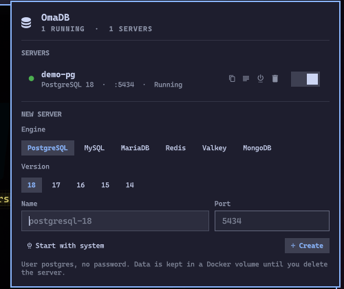

# OmaDB: local database servers for Omarchy



A DBngin-style database manager for the Omarchy bar. Click the 󰆼 icon to:

- **Create** a server: pick an engine (PostgreSQL, MySQL, MariaDB, Redis,
  Valkey, MongoDB), a version, a name and a port. A free port is suggested
  automatically, so several versions of the same engine run side by side.
- **Start / stop** it with the switch
- **Copy** its connection URL (󰆏), open its **CLI client** in a terminal (󰆍),
  follow its **logs** (󰦪)
- Make it **start with the system** (󰐥)
- **Delete** it and its data (󰆴, click twice)

The bar shows how many servers are running; hover for the list.

## How it works

Each server is a Docker container named `omadb-<name>`, labelled
`omadb.managed=1`, published on `127.0.0.1` only, with its data in the named
volume `omadb-<name>`. Stopping, starting and restarting keep the data; only
Delete removes the volume. Containers OmaDB did not create are never touched.

| Engine     | Default port | User / password    | Client     |
|------------|--------------|--------------------|------------|
| PostgreSQL | 5432         | `postgres`, none   | `psql`     |
| MySQL      | 3306         | `root`, none       | `mysql`    |
| MariaDB    | 3306         | `root`, none       | `mariadb`  |
| Redis      | 6379         | none               | `redis-cli`|
| Valkey     | 6379         | none               | `valkey-cli`|
| MongoDB    | 27017        | none               | `mongosh`  |

These are development servers: passwordless and reachable from this machine only.

## Requirements

- Omarchy 4 (the Quickshell-based `omarchy-shell` bar)
- Docker, running, with your user in the `docker` group (`omarchy install docker`)
- `jq`, `ss`, `wl-copy`, which ship with Omarchy

## Install

From git:

```bash
omarchy plugin add https://github.com/alshareedah22/omadb.git --enable
```

Or from a local copy:

```bash
mkdir -p ~/.config/omarchy/plugins/blackcode.omadb
cp manifest.json Panel.qml dbctl LICENSE ~/.config/omarchy/plugins/blackcode.omadb/
omarchy plugin enable blackcode.omadb --section right
```

## Command line

```bash
dbctl state                                  # JSON: docker status, engines, servers
dbctl create postgresql 17 app-db 5433 on    # empty port = next free one
dbctl start|stop|restart app-db
dbctl url app-db                             # postgresql://postgres@127.0.0.1:5433/postgres
dbctl client app-db
dbctl remove app-db [--keep-data]
```

## Remove

```bash
omarchy plugin remove blackcode.omadb
```

Servers keep running until you delete them; list leftovers with
`docker ps -a --filter label=omadb.managed=1`.
